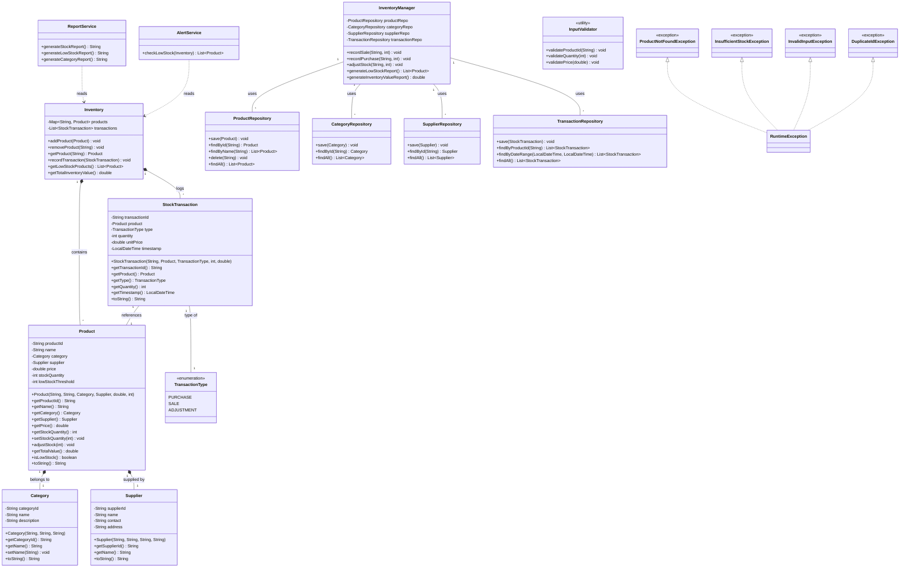

# Inventory Management System — System Architecture

## 1. Architectural Style
Layered, modular, console-based Java application. Responsibilities are separated into packages so each layer has a single, clear purpose. Business logic is independent of the UI, which makes unit testing straightforward.

## 2. Package Responsibilities

| Package | Responsibility | Contents |
|---------|----------------|----------|
| `model` | Domain entities and data holders. Plain Java classes with fields, constructors, getters/setters, `toString`, `equals`, `hashCode`. No business logic here. | `Product`, `Category`, `Supplier`, `StockTransaction`, `TransactionType` (enum) |
| `service` | Business logic and application orchestration. Validates input, enforces rules (e.g. no negative stock), coordinates repositories, raises alerts. | `InventoryManager`, `ProductService`, `StockService`, `ReportService`, `AlertService` |
| `repository` | Data access / storage abstraction. In-memory for Phase 0–4; designed so a database can be swapped in later without changing service code. | `ProductRepository`, `CategoryRepository`, `SupplierRepository`, `TransactionRepository`, `InventoryRepository` |
| `data_structure` | Custom data structures and algorithms demonstrating DSA. Used by repositories instead of blindly relying on built-in collections. | Custom list, map, set, queue, stack, search, sort implementations |
| `utility` | Cross-cutting helpers with no domain knowledge. | `InputValidator`, `DateUtils`, `IdGenerator`, `CurrencyFormatter` |
| `ui` | Console user interface only. Captures input, displays output, calls service methods. No business logic. | `MainMenu`, `ProductUI`, `TransactionUI`, `ReportUI` |
| `exception` | Custom checked/unchecked exceptions for domain errors. | `ProductNotFoundException`, `InsufficientStockException`, `InvalidInputException`, `DuplicateIdException` |

## 3. Dependency Direction
```
ui  -->  service  -->  repository  -->  data_structure
                     -->  utility
                     -->  exception
model <-- service, repository, ui (data only)
```
- `ui` depends on `service` and `model`.
- `service` depends on `repository`, `model`, `exception`, `utility`, `data_structure`.
- `repository` depends on `model`, `data_structure`, `exception`.
- `data_structure`, `utility`, `exception` depend on nothing (or `model` only where needed).
- No package depends on `ui`.

This keeps business logic testable without launching a console.

## 4. Data Flow Example (Sale)
1. `ui.SaleUI` captures product ID and quantity from the user.
2. Calls `service.InventoryManager.recordSale(productId, quantity)`.
3. `InventoryManager` validates input via `utility.InputValidator`.
4. Loads `Product` from `repository.ProductRepository`.
5. Checks stock via business rule; throws `InsufficientStockException` if not enough.
6. Creates `StockTransaction` (type SALE), saves to `repository.TransactionRepository`.
7. Updates product stock in `repository.ProductRepository`.
8. Returns confirmation to `ui`.

## 5. Extensibility Notes
- Repositories are interfaces (or abstract classes) so persistence can change from in-memory to file/database in later phases.
- `data_structure` isolates custom DSA implementations so swapping them does not touch business logic.
- Enums (`TransactionType`) keep transaction kinds type-safe and easy to extend.

## 6. UML Class Diagram (Mermaid)


